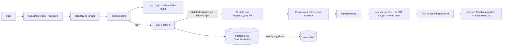

# Nailed It Kitchen

A simple recipe app: browse, search and read ingredients followed by cooking instructions.
The first usable release is the **beta**; advanced recipe grids and other extras come later.

**URL:** https://naileditkitchen.dylanlabs.dev (not live yet)

> **Status:** beta scope is agreed; the frontend shell exists and the rest of the application is in
> progress. The site is not live yet. GitHub has one Beta delivery epic and a separate Post-beta
> backlog. Follow actual prerequisites and native issue dependencies, not legacy phase or sequence
> numbers.

## Team

- [@dylanwhitetech](https://github.com/dylanwhitetech)
- [@ArthurW2](https://github.com/ArthurW2), Principal Engineer (frontend)

Both of us own the whole repo (see `CODEOWNERS`). Issues are unassigned; pick any ready issue whose
actual prerequisites are complete.

> **Contributions:** this repo is public but does not accept outside issues or PRs.
> Recipe submissions are planned through the app; feedback is Post-beta. See
> [CONTRIBUTING.md](CONTRIBUTING.md) for the collaborator workflow.

## Architecture



It runs on a 3-node Raspberry Pi 4 (arm64) k3s cluster managed with Flux in
[dylanwhitetech/k3s-infrastructure](https://github.com/dylanwhitetech/k3s-infrastructure).

## Decisions & why

| Area | Decision | Why |
|------|----------|-----|
| Frontend | React + Vite + TypeScript, Oxlint, Vitest | React is the most common UI library, so help and components are easy to find. Vite gives instant dev reloads and simple builds. TypeScript catches mistakes early. Oxlint and Vitest are fast and fit Vite. |
| Backend | FastAPI (Python 3.12), Ruff, pytest | Typed and fast, generates OpenAPI docs automatically, and Python keeps the API simple. Ruff and pytest are the standard fast lint/test tools. |
| Database | PostgreSQL via CloudNativePG, SQLAlchemy + Alembic | Store plain recipes and durable view counts with built-in keyword search. Later fields use ordinary migrations rather than speculative tables. |
| DB storage | `local-path` volume pinned to one node + nightly `pg_dump` to NFS | Running Postgres directly on NFS risks corruption. Local disk is safe and fast; the nightly dump on the NFS share is the backup. |
| Recipe format | Reviewed YAML: slug, title, ingredient text lines and ordered instruction text steps, plus optional plain-text source and notes ([format](docs/recipe-format.md)) | A small JSON Schema keeps storage, submissions and rendering consistent. No grid/DAG model in beta. |
| Recipe submissions | Paste template → editable preview → protected API → one recipe PR → CI → human merge | Deterministic parsing, no AI provider or intermediate issue. GitHub supplies review and history. |
| Popularity | Approximate detail-view counts in Postgres | Most-viewed on the landing page without accounts, visitor identities or a separate analytics service. |
| Accounts | None in beta; Turnstile, rate limits and server validation protect submissions | A small audience is not a security boundary. Ratings, comments and feedback forms are Post-beta. |
| Photos | Post-beta | Text-only recipes keep storage and moderation simple. |
| Containers | Docker Desktop for local dev; multi-arch (amd64/arm64) images on GHCR; k3s runs them with containerd | The same images will run on laptops, in CI and on the Pis. The planned Compose stack starts locally with one command. |
| Hosting | Helm chart → OCI on GHCR → Flux in k3s-infrastructure; Cloudflare Tunnel → ingress-nginx | GitOps: the cluster state is in git and every change is a reviewed PR. The tunnel avoids opening home ports and Cloudflare handles TLS. |
| GitHub from the API | GitHub App `naileditkitchen-bot`; beta needs Contents and Pull requests write approval | Short-lived repository-scoped tokens. The verified issues-only setup does not yet support the planned PR workflow. |
| Styling | Simple CSS, small React components and original NIK branding | Clean beta first; Arthur can restyle it later without a design-system dependency. |
| AI-first | `AGENTS.md` rules plus Copilot agents, skills and instructions in `.github/`; decisions in `guidance/` | Copilot follows the same rules as humans, and anyone can hand it an issue. |

## How recipe submission works

This is the agreed beta contract; the recipe format, validator, paste extraction rules and
submission protections exist ([recipe format](docs/recipe-format.md),
[recipe submissions](docs/submissions.md)); the submission form and GitHub publishing do not yet:

1. Paste one recipe using the template below. Deterministic parsing produces an editable preview.
2. Confirm the preview after the form warns that the submission will be public on GitHub.
3. The server validates the recipe, verifies Turnstile, enforces per-client and aggregate rate limits,
   and uses `naileditkitchen-bot` to add one new recipe file in a PR. No intermediate issue or AI step.
4. CI validates the file as data; a CODEOWNER reviews and merges. Recipe PRs never merge automatically.
5. The release/promotion workflow and Flux publish the reviewed recipe to Postgres.

```text
Recipe title

Ingredients
- First ingredient
- Second ingredient

Instructions
1. First cooking instruction.
2. Second cooking instruction.
```

An optional `Source:` line after the title and an optional `Notes` section after the instructions
are also accepted.

The server-side switch defaults submissions off, and submissions also stay unavailable until GitHub
publishing is configured. Disabling submissions leaves browsing/search available. Requests are
limited to 32 KiB and recipe content to 20,000 characters; text is validated, safely serialized and
rendered as text, never executed. Malformed or ambiguous recipes must be corrected rather than
guessed at. Human review still matters.

## Beta scope

**In:** clean mobile-friendly UI and NIK logo, most-viewed section, paginated A-Z browsing, keyword
search across title/ingredients/instructions, plain recipe pages, protected recipe PR submissions,
durable Postgres data, repeatable release/deployment, backups and a verified restore.

**Post-beta:** grid/DAG recipes, tags and richer metadata/filtering, semantic search, ratings,
"I made this", feedback forms, visual polish/design systems, accounts, photos, comments, servings
scaling, print view and AI conversion. Optional Copilot tooling does not block beta.

## Run & test locally (Docker)

> **Not implemented yet:** Compose is beta integration work.
> The Compose commands below are the intended contract, not evidence that the current checkout runs.
> `.env.example` contains the disabled submission switch and Turnstile test keys; no Compose service reads it yet.

**Once implemented, do this before every push.**

1. Install and start **Docker Desktop**. Check it works: `docker compose version`.
2. Copy `.env.example` to `.env` (no real secrets needed locally).
3. Start everything: `docker compose up --build`
   - Web: http://localhost:8080
   - API: http://localhost:8000 (docs at http://localhost:8000/api/docs)
   - Postgres: `localhost:5432`
4. Run the [backend](docs/backend.md), [frontend](docs/frontend.md) and
   [recipe](docs/recipe-format.md#validate-recipes-locally) checks documented with their implementation.
   The recipe checks require Python, not Docker. [CI](docs/ci.md) runs the same checks on every
   pull request and lists their exact local equivalents.
   The optional Post-beta `local-preflight` skill is not required.
5. Reset the database: `docker compose down -v` (deletes local volumes and their data).

## AI-first workflow

Everything Copilot needs is in the repo, so it works the same in VS Code, the GitHub Copilot app,
the Copilot CLI and the Copilot cloud agent on GitHub.

| File | What it does |
|------|--------------|
| `AGENTS.md` | Canonical rules for agents and humans (source of truth). `.github/copilot-instructions.md` points to it. |
| `guidance/` | Lasting decisions (architecture, stack, deployment). Check before new work; update in the same PR. |
| `.github/instructions/*.instructions.md` | Extra rules for certain paths (code review, Copilot authoring). |
| `.github/agents/naileditkitchen-main.agent.md` | **Main agent: select it for each session.** Plans, implements, and delegates. |
| `.github/agents/naileditkitchen-test.agent.md` | Writes and runs tests (background subagent or its own session). |
| `.github/agents/naileditkitchen-deploy.agent.md` | Releases, promotion PRs to k3s-infrastructure, read-only rollout checks. |
| `.github/skills/gh-issue-drafter/` | Drafts from the target repo's actual issue form and reconciles labels, epics, dependencies, and Project fields. |
| `.github/skills/gh-pr-drafter/` | Issue-prefixed branch/PR names, Conventional Commit messages, and the PR template. |
| `.github/skills/visual-explanation/` | Explains a topic with a concise visual or focused, accessible HTML artifact. |
| `.github/skills/field-notes/` | Records agentic learnings/blockers in the session folder (never the repo) for a curator. |
| `.github/skills/copilot-authoring/` | Standards for agents, skills, instructions and templates, plus the resource catalogue `references.md`. |

Code review uses the built-in Copilot code review on GitHub, guided by
`.github/instructions/code-review.instructions.md`.

[`AGENTS.md`](AGENTS.md) defines our shared engineering standards and sourced code-documentation
rules: Google-style Python docstrings, TSDoc for reusable TypeScript/React APIs, and intentional
FastAPI/Helm documentation.
Branch names and PR titles use `<type>/<issue-number>-<short-hyphenated-description>`
(e.g. `feat/1234-add-feature-x`), with only `feat`, `fix`, `cicd`, or `chore`.
Commit messages separately follow [Conventional Commits](https://www.conventionalcommits.org/en/v1.0.0/).
Existing session-managed branches are not renamed. For squash merges, the human merger
must use a Conventional Commit message rather than the slash-form PR title.

### Selecting the main agent

No automatic repository default for `naileditkitchen-main` has been established. The agent sets
`disable-model-invocation: true` to prevent automatic selection by Copilot in the cloud. Select it
per session on a supported surface:

| Surface | How |
|---------|-----|
| GitHub Copilot app | Agent picker in the prompt box, or type `/agent` and choose `naileditkitchen-main`. |
| Copilot CLI | `copilot --agent naileditkitchen-main`, or `/agent` inside a session. |
| VS Code | Agent dropdown in Copilot Chat. |
| Cloud agent on GitHub.com | Pick it from the agent dropdown in the agents panel/tab, or when assigning an issue to Copilot (only after the file is on the default branch). |

**New to agentic work? Try this:**

1. **VS Code:** open the repo, open Copilot Chat, pick **naileditkitchen-main** from the agent dropdown, and say
   "Work on issue #<n>". It reads the issue and guidance, writes code, and delegates tests to `naileditkitchen-test`.
2. **GitHub Copilot app / CLI:** open the repo, select the `naileditkitchen-main` agent (`/agent`), and give it the issue.
3. **Cloud agent on GitHub:** on an issue marked `Copilot-ready? yes`, assign it to **Copilot** and pick `naileditkitchen-main`. It opens a PR for you to review.
4. Always review the PR yourself. Copilot code review also comments automatically.
## Repo layout

Currently present:

```text
frontend/        React/Vite web app and its nginx image (see docs/frontend.md)
backend/         FastAPI, migrations, recipe seeder and API image (see docs/backend.md)
recipes/*.yaml   Reviewed plain-text recipes (docs/recipe-format.md)
recipes/schema/  Recipe JSON Schema; recipes/validate.py validates and extracts
recipes/source/  Original recipes used as test fixtures
docs/            Contributor, CI, repository setup and recipe format
guidance/        Lasting decisions (one record per decision)
.github/         Copilot agents, skills, instructions, templates, workflows
```

Planned, not present yet: `deploy/chart/` (Helm chart). Its implementation will document
the exact deployment commands; no placeholder Make targets are provided.

## Related repos

- [dylanwhitetech/k3s-infrastructure](https://github.com/dylanwhitetech/k3s-infrastructure): cluster, Flux, Cloudflare Tunnel, CloudNativePG, secrets
