# Releases and promotion

Releases are automated but human-gated: release-please proposes versions, a trusted workflow
publishes the Helm chart for each release, and a promotion pull request in
`dylanwhitetech/k3s-infrastructure` changes what runs. Automation never merges a pull request,
never pushes a hand-made tag, and never changes the cluster directly.

```mermaid
flowchart LR
  M[Conventional Commits on main] --> CI[CI succeeds: SHA images]
  CI --> RP[Release workflow: release-please PR]
  RP -- human merges --> TAG[vX.Y.Z tag + GitHub Release]
  TAG --> CI2[CI succeeds for the merge commit]
  CI2 --> PUB[Images and chart X.Y.Z pushed to GHCR]
  PUB --> PR[Promotion PR in k3s-infrastructure]
  PR -- human merges --> FLUX[Flux upgrades the HelmRelease]
```

## Files

| File | Purpose |
| --- | --- |
| `release-please-config.json` | release-please settings: one `simple` package, tags `vX.Y.Z`, first version `0.1.0`, updates the chart version marker. |
| `.release-please-manifest.json` | The released version; release-please updates it in each release PR. Never edit by hand. |
| `.github/workflows/release.yml` | Trusted `Release` workflow: release PR/tag, chart publication, promotion PR. |
| `scripts/release/release_tool.py` | Publish and promote logic used by the workflow; tested by the `Release tooling` CI job. |
| `deploy/chart/naileditkitchen/Chart.yaml` | `version: X.Y.Z # x-release-please-version` is owned by release-please. |

## Versions

- release-please reads Conventional Commits on `main` (the squash message a human sets when
  merging). `fix:` bumps the patch version. While the version is `0.x`, `feat:` and breaking
  changes bump the minor version.
- The first release is `0.1.0`. The repository version, the Git tag `vX.Y.Z`, the GitHub Release
  and the chart version are always the same number.
- The release PR is titled `chore(main): release X.Y.Z` and updates `CHANGELOG.md`, `version.txt`,
  the manifest and the chart version. Keep that title as the squash message.
- CI publishes full-commit-SHA image tags. The release workflow copies each verified multi-arch
  image index to a matching `X.Y.Z` tag without rebuilding or replacing a conflicting version
  tag. There is no `latest` tag. The chart pins the same indexes by digest.

## The Release workflow

The workflow starts only when the `CI` workflow succeeds for a push to `main` in this repository,
or when it is dispatched manually on `main`. Pull request code, forks and failed CI runs never
reach it.

1. **Release PR and tag** (`contents`, `issues` and `pull-requests: write`): release-please opens
   or updates the release PR. When a merged release PR is on `main`, it creates the `vX.Y.Z` tag
   and GitHub Release at that merge commit.
2. **Publish images and chart** (`packages: write`): for each recent release whose chart version
   is not in GHCR, oldest first, it:
   - verifies `ghcr.io/dylanwhitetech/naileditkitchen-{api,web}:<release commit SHA>` exist with
     `linux/amd64` and `linux/arm64` and that commit's revision annotation;
   - creates `X.Y.Z` aliases for both verified image indexes and verifies their digests match;
     existing conflicting tags fail instead of being overwritten;
   - extracts the chart from the release commit, sets `appVersion` to the full commit SHA and sets
     each image's tag and index digest (only in the packaged copy);
   - lints, packages and pushes `oci://ghcr.io/dylanwhitetech/charts/naileditkitchen:X.Y.Z`.

   A published chart version is never overwritten. If a release commit's images are not published
   yet, the run defers it (a later CI success for that commit publishes it) unless that commit
   triggered the run, in which case the job fails.
3. **Open promotion PR** (`INFRA_PR_TOKEN`): bumps `spec.chart.spec.version` in the HelmRelease
   file configured by `NIK_HELMRELEASE_PATH` in `dylanwhitetech/k3s-infrastructure`, on branch
   `automation/naileditkitchen-chart-X.Y.Z`, and opens a PR using that repository's template. It
   refuses downgrades, reports an already open PR, and fails if the branch exists without a PR.

Each job writes what it did to the run summary. A failure in a later job never removes an earlier
artifact; rerun the workflow after fixing the cause.

### Manual runs

Run **Actions → Release → Run workflow** on `main`:

- with no input to retry release-please and publish any missing chart versions;
- with `promote_version` set to an already published version to retry its promotion PR, for
  example after `INFRA_PR_TOKEN` is renewed or first onboarding merges.

## First onboarding

Automation only bumps an existing HelmRelease. Until the reviewed k3s-infrastructure change that
adds the `naileditkitchen` HelmRelease (namespace `naileditkitchen`, chart `naileditkitchen` from
the OCI HelmRepository `oci://ghcr.io/dylanwhitetech/charts`, pinned to a published version) has
merged, the promotion job fails with "published but NOT promoted". That is the expected result,
not a successful promotion:

1. Merge the release PR so `0.1.0` is published.
2. Confirm the chart is pullable (see [Artifact visibility](#artifact-visibility)).
3. A human reviews and merges the onboarding change in k3s-infrastructure pinned to `0.1.0`.
4. The owner sets repository variable `NIK_HELMRELEASE_PATH` to the actual merged HelmRelease
   file path relative to the infrastructure repository root. The proposed path is
   `kubernetes/apps/naileditkitchen/helmrelease.yaml`; verify the merged file rather than assuming
   it. An unset, invalid, or missing path fails promotion.
5. Later releases open ordinary promotion PRs. Run the workflow with `promote_version` only if a
   newer version was published before onboarding merged.

## Promotion review and rollout

The promotion PR is never merged by automation. Before merging it, a human:

- checks the release notes and the infrastructure repository's checks;
- reads any migration notes for the release (database migrations run before the new pods);
- merges, then verifies the rollout read-only (`flux get helmreleases -n naileditkitchen`, pods,
  the migration job and the site).

## Rollback

There is no hand tagging and no automated downgrade (the tool refuses one). To roll back:

1. Open a reviewed revert of the promotion PR in k3s-infrastructure; a human merges it and Flux
   reinstalls the previous chart version.
2. If the release ran a database migration that the previous version cannot use, follow the
   chart's migration and backup recovery procedure before or with the revert; do not rely on the
   revert alone.
3. Fix forward in this repository; the next release follows the normal flow. Published chart
   versions and images stay available for audit.

## Artifact visibility

Flux and anonymous users pull the chart and images from GHCR. After the first publication, the
owner verifies (and records in the launch checklist) that:

- `charts/naileditkitchen`, `naileditkitchen-api` and `naileditkitchen-web` are **public** in the
  owner's GHCR packages and are connected to this repository (the chart's `sources` and the
  images' `org.opencontainers.image.source` provide the link);
- `helm show chart oci://ghcr.io/dylanwhitetech/charts/naileditkitchen --version X.Y.Z` and
  `docker buildx imagetools inspect ghcr.io/dylanwhitetech/naileditkitchen-api:<sha>` work while
  logged out.

## Owner settings and credentials

These are owner-controlled; the workflow never changes them.

- **Actions can create pull requests:** release-please needs repository setting *Settings →
  Actions → General → Allow GitHub Actions to create and approve pull requests* enabled. Approval
  is not used; CODEOWNERS review is still required.
- **Release PR checks:** pull requests opened with the workflow token do not start other
  workflows, so `CI` does not run on the release PR automatically. Close and reopen it (or push a
  commit to it) so required checks run before merging.
- **`INFRA_PR_TOKEN`:** a repository secret, referenced only by name. It is a fine-grained token
  limited to `dylanwhitetech/k3s-infrastructure` with contents and pull requests read/write; it is
  used only by the promotion job and never printed.

### `INFRA_PR_TOKEN` renewal

The repository owner owns this token. At launch and at each renewal, the owner verifies:

- its resource owner, single-repository access and permissions match the list above;
- its expiry date, and that a dated renewal reminder (an item in the owner's project or calendar,
  at least two weeks before expiry) exists;
- after replacing the secret, a manual run with `promote_version` set to the current version reports
  either an open PR or "already pins", confirming chart and infrastructure read access. An
  "already pins" result does not test push or PR creation permissions; verify those separately.

When it expires, publication continues but promotion fails, so releases are published but NOT
promoted until it is renewed.
